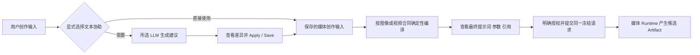

# MODEL_PROVIDER — 模型供应与 Provider 权威

Status: current（入口见 [CURRENT.md](CURRENT.md)）；
Provider 接入契约见 [adr/0005-provider-plugin-driven-configuration.md](adr/0005-provider-plugin-driven-configuration.md)。

新 Create 在提交标记前锁定并重新读取当前 Binding/Connection 资格，Catalog 与维护同步
共用事务协调锁，运行角色保持 Catalog 只读权限。准入必须匹配
最新连接和凭据修订以及该修订下的正向模型可见性证据。旧排队计划在轮换后失效；已提交
任务仍按原身份恢复。仅有 `@contract/...` 协议 Fixture 和 `/models` 可见性的动态模型
返回 `DYNAMIC_MODEL_CAPABILITY_UNVERIFIED`，在精确能力确认机制完成前不开放新 Create。
退役审查记录位于 `catalog_publication_events.json`，只降低唯一 Catalog 的发布资格，不
改写旧能力 JSON/Hash。Agnes Video V2.0 已按官方页面下线声明阻断新 Create；历史身份
和素材保留。无法匹配已冻结 Handler 的历史任务必须人工核对，不自动重发。

首批六个既有 Active 官方修订的可执行字段尚缺完整官方审核，已在同一发布事件文件
登记精确 revision/hash 的 `MODEL_OFFICIAL_EVIDENCE_GAP` 新 Create 限制。该限制由
候选资格、模型解析和提交前准入共同消费，不改变 lifecycle、Binding 或旧 Manifest。
只读查询仍显示冻结合同与候选知识，纯 Provider Compiler Fixture 可离线检查；候选
知识和账号目录成功均不能解除该冻结修订的限制。已提交任务的恢复不读取新准入事件。

## 当前唯一模型执行系统

Director 送入文本模型的上下文快照最多 512 KiB（UTF-8 字节）。超限在创建 Turn 和
模型调用前返回 `DIRECTOR_CONTEXT_TOO_LARGE`，要求缩小请求范围；不静默截断或改写
冻结上下文。输出 token 上限另行约束输出，不能替代该输入限制。

来源登记、不可变来源快照和追加检查记录集中在
`backend/app/providers/model_sources/` 的三个 JSON 文件。来源目录只保存 URL、精确适用
范围及证据元数据，不能定义能力或替代 Manifest。原二十份捕获保持 `unreviewed`；
后续审核追加独立快照，十份新审核覆盖精确型号/API/地区及实际声明的字段。
HTTP 200、SDK 示例和 Compiler Fixture 不会自动赋予字段官方支持。

新合同的证据关联通过 `source_evidence.resolve_field_evidence` 解析：显式字段 override
优先，其次最近能力/输入组，最后操作组。字段必须有自身声明状态，父组不能把未知字段
升级为支持。`covers` 使用 JSON pointer；`reviewed_manifest_subtree_hash` 包含能力值、
支持状态和条件/派生/强制规则，排除来源及审核元数据。新增字段或修改值会使旧审核
失效；参数名及字面 JSON 中同名的 `checked_at/source_url` 仍属于能力语义。

维护命令 `scripts/model_source_evidence.py` 提供 `lint`、`register --record-json`、
`snapshot --record-json --body` 和 `check --record-json`，可用 `--root` 指定离线副本。
捕获快照必须提交实际哈希一致的正文；重复身份不同内容被拒绝，检查仅追加，旧时间戳
原样保留。命令不联网、不解密、不写 Manifest、不开放模型；并发写入直接拒绝。
来源后续修订采用新快照/检查 ID，旧引用继续解析。生产调用只读取 Manifest 能力，
不从 URL 内容或检查记录动态推断参数。

Catalog 的版本入口 `read_catalog_manifest` 读取冻结 V1 与类型化 V2。V2 显式区分
bounded / unknown / unlimited，支持未实现的编辑、延长与分层操作、逐素材和聚合限制、
声明式组合/派生规则。它通过同一 CapabilityResolver 校验实际输入和字段级证据，
最终选项再次检查组合约束；匹配成功不注册 Compiler 或开放 Create。V2 暂为候选，
Loader 拒绝未经实施发布的 Active。V2 Hash 排除生命周期和文档日期；V1 原算法、
JSON、Fixture 与历史执行语义冻结不变。

首批二十个型号/合同身份各有一个 V2 候选，覆盖原二十四个修订。`knowledge_projection`
把操作、参数、逐素材/聚合限制、分组来源、未知/冲突及实施状态投影到现有查询 API，
当前 Binding 的窄合同和附带的候选知识分别显示版本与 Hash。Candidate 的官方事实
不提升当前绑定资格，未实施操作不注册 Runtime。编译用的参数与固定输出事实分开：
例如帧率/产物格式和图层上限只作为协议观察；来源范围未知仍明示阻塞。
来源链接按实际引用的 Snapshot 单独投影，检查日期只来自该引用的追加检查，不能
借同一 URL 的另一个已审核型号授予支持。设置页的能力说明为只读；实际高级控件
继续使用已经实施的 CapabilitySpec，候选知识不注册输入控件或生成动作。

`scripts/audit_model_knowledge.py` 可把冻结 Inventory 与显式审核映射对照新候选，
分别报告身份覆盖、观察分类、结构化映射、来源证据、Compiler 和产品开放；只输出到
新的 `tmp/` 目录，不联网、不访问数据库、不发布。来源注记和退役事实保留在报告中，
不进入可执行能力覆盖的分母。检查日志变化不会改写既有修订。

项目尚未发布。模型执行统一为文件 Catalog/Manifest、具体 ProviderModelBinding、
Connection/Credential revision、严格 Compiler 和 ExecutionIdentitySnapshot。
未接入生产的 Global/Dynamic 第二套能力表、Policy/Protocol/Handler 表与 Cutover 预检
服务已退役；不保留旧系统回滚路径或自动转换旧运行计划。

- 新媒体 Create 只接受当前 active、合同可复现且通过账号验证的具体 Binding。
- Media Profile 可以引用 `binding:<UUID>`，同名模型不再按更新时间或供应商名字选第一条。
- 文本统一为 `litellm/<logical-alias>`；连接发现的模型使用
  `litellm/<connection-UUID>/<remote-model-id>`，不同地址与凭证不会互相覆盖。
- 单一文本请求是非空 messages 列表；图片素材是有序 reference_artifact_ids 列表。
  旧 prompt/system 简写、单 reference_artifact_id 和 translate_v2 不再是执行接口。
- 媒体通过工作台预览和显式确认，工作台冻结 WorkbenchExecutionPlan，实验图在排队前冻结相同 ExecutionModelResolution；Worker 缺少计划
  与已冻结执行身份时拒绝执行，不能转去重新选模型或单独生成。
- ProductCapabilityPolicy 是编译时的显式产品开放子集，不引入另一套策略存储。
- 实际提交在执行身份内保存产品策略快照及精确协议/实现指纹；属于原执行的冻结
  证据，不建立第二套 Policy、Handler 或 Runtime。历史身份没有这些事实时只报告
  阻塞，不能自动补造。当前策略与可见性重新检查只用于新 Create。
- ProviderAvailabilityEvidence 为模型、连接和凭证修订的追加证据，Availability 是其
  当前投影；静态合同、目录列表、账号执行验证和人工质量认证必须分别表述。

当前修订必须显式声明 implementation_status；contract_tested 还需可复现合同证据。
不再按旧 hash 白名单补足状态。preview 只可用于离线检查，不能注册为可执行绑定。
当前离线测试不证明任何实际账号或作品质量。

### 离线能力基线审计

`scripts/audit_model_capabilities.py` 复用唯一 Catalog Loader，冻结精确型号/协议/修订、
原文件与 Manifest Hash，枚举操作、参数、输入、限制和未结构化的功能声明，并核对
同一修订的 Fixture。首批统计为 Agnes、MiniMax、Volcengine；其他协议合同另列上下文。
目录声明、官方事实、Compiler 测试、产品开放与账号可用分别报告。型号级
`contract_tested` 与 Fixture 关联不能认证每条能力，逐能力实施验证缺证据时保持未核验。
Catalog 字段保留数量仅说明读取结果；声明值映射的分母是明确识别的官方能力事实，
SourceAnnotation 不进入能力分母，枚举值按一项事实统计。未评估、明确缺失和值失配
分别计数；未录入逐事实映射审核时不报告 0% 覆盖。路径和值吻合不认证完整 typed 合同
或 Compiler 实施。现有来源缺少审核
覆盖时，审计状态为 `unknown`，不改变既有合同或自动停用当前 Binding。
发布验收要求的显式新 Create 限制由发布事件投影单独报告，不把限制伪装为型号退役。

在 backend 质量容器的锁定环境中，以 `/workspace` 为工作目录运行：

```sh
PYTHONPATH=/workspace/backend uv run --project backend python scripts/audit_model_capabilities.py --output-dir /workspace/tmp/model-audit/new-check
```

可用 `--observations <JSON>` 附加人工核验的源码/数据库/官方资料记录，用
`--compare <前次审计JSON>` 检测同一修订 Hash 被修改。观察记录不提升能力证据等级。
原文陈述、型号/协议/区域适用性、合同证据状态独立记录；原文的 `documented_supported`
不提升适用性未核实的合同。新增观察字段没有显式状态时为 unknown，不继承父级肯定。

`--source-checks <JSON> --source-bodies <目录>` 可选读取已采集缓存：先核对原响应 Hash，
再以纯 JSON 解析正文（包括 Ark 的 `window._ROUTER_DATA` / `MDContent`），不执行
JavaScript。提取正文、HTTP 200 和正文 Hash 都不授予能力支持；原响应保持不变，
衍生正文写入新报告的 `source-texts/`。正文已获取但未审核为 `extracted_unreviewed`，
不应记为来源不可用。

该命令不联网、不访问数据库、不调用 Provider、不修改目录或运行状态；输出仅允许
位于 `tmp/` 的新目录，拒绝覆盖旧报告。一次性基线和误删审计不进入当前权威文档树。
它不代替官方来源审核、只读历史恢复预检或发布质量 Gate。

## Model Capability / Prompt Compiler 详细指南

[逐模型能力与编译指南](architecture/MODEL_CAPABILITY_PROMPT_COMPILER.md) 维护当前
文件目录中的官方模型、协议合同、候选与历史 revision，以及逻辑文本和语音实现的源码合同、参考槽位、参数/Prompt
编译链及 Agent 查询设计。它不替代 Manifest，也不证明当前账号已通过 Probe。
供应商页面声明、项目开放子集、账户执行证据必须分别标注；官方退役公告与固定 catalog
的差异需显式呈现，不能自动换模型、扩能力或覆盖冻结执行身份。
模型能力查询、无副作用编译预览与生成快照已由 production/model_inspection.py 的只读service及
api/v1/model_inspection.py 提供。预览复用原compiler，使用占位reference且不证明账号/传输就绪；
不写NodeRun/ProviderOperation或调用Provider。Agent ToolRegistry与自主工具循环仍未实现。
无命名输入模式的目录仍按槽位和原 Compiler 校验；编译预览接受既有工作台关键帧的
`text_to_image` 与视频的 `first_frame` 阶段名。跨媒体阶段名和未知模式仍会阻止预览，
有命名合同的模型只接受实际声明的合同 ID。

## 分层

LLM 配置通过现有工作空间连接的 `/gateway` 管理接口登记，`gateway_ref` 仅保存部署
UUID/版本别名、所属连接/空间、配置指纹、Key 修订和配置操作状态；上游 URL/Key 只在
LiteLLM DB 可修改。连接自身保存固定 Proxy 地址及其数据面凭据修订，不保存第二份上游 Key。
变更 URL/model 创建新部署版本；Key 轮换使用锁定版 PATCH API，保持逻辑选项和目标。
受管版本禁止原地换目标、保留引用不能删除；执行引用和 Key 变更共用单部署锁。
`gateway_registered` 只证明代理配置读后核验，**不证明上游已认证或真实生成成功**。

配置写入先提交持久标记；响应丢失或本地回写失败后仅按精确 ID 查询，不再次创建。
全局 Proxy URL/数据 Key 变化时旧连接失败关闭，必须显式迁移数据面身份，不能静默采用新部署。
受管连接不走旧凭据写入/发现接口；其保留命名空间不进入全局发现 Registry。
本阶段管理入口已具备；生产文本调用的单向切换及旧入口退役仍须按后续 Gate 验收。

Proxy 部署已锁定 LiteLLM 1.96.0 的镜像 digest，并开启 DB 模型持久性。其独立网络
namespace 对目的 IP/端口默认拒绝，模型上游需要显式网络授权；不影响媒体网络。
当前请求禁止自动重放、跨模型 fallback、HTTP 重定向及请求级目标/凭据覆盖；同名
YAML/DB 创建会被拒绝。Master/SALT 不传给 API 或 Worker。详见
[部署边界](DEPLOYMENT.md) 和 [Proxy 配置](../infra/litellm/README.md)。
这部分基础设施不表示工作区文本直连已完成 G2 切换，也不把可变 Proxy UUID 当成
不可变模型修订；旧记录、凭据与正式素材保持原样。

| 层                                         | 位置                                                                            | 职责                                                                                              |
| ------------------------------------------ | ------------------------------------------------------------------------------- | ------------------------------------------------------------------------------------------------- |
| ProviderPlugin + ModelCatalogEntry         | backend/app/providers（registry、catalog_*）                                    | 只读插件契约：供应商名称、Base URL、协议、模型 ID、能力列表；前端不写死任何供应商事实             |
| ModelManifest                              | backend/app/providers/manifest.py                                               | 对外能力唯一事实源：模型、模式、参考槽位、输入约束                                                |
| Workspace Provider Connection / Credential | providers/models.py, connection_service.py, workspace_credentials.py, security/ | BYOK 加密凭据（Fernet）、不可变 connection/credential revision、key rotation 审计；界面不回读 Key |
| Production Model Profile                   | providers/model_profiles/                                                       | 项目/工作台级模型绑定与冻结                                                                       |
| ExecutionModelResolution                   | providers/model_resolution.py, execution_identity.py                            | 执行身份：冻结 model、binding、connection/credential revision、mode 与 reference identity         |
| TransportProfile                           | providers/transport.py, transport_registry.py                                   | 不可变协议事实声明（endpoint、认证方式、编码、poll/cancel），不含凭证与业务 payload               |
| Compiler / Runtime                         | providers/adapters_v2.py, runtime.py 与各 Provider 实现                         | Compiler 唯一构造 wire_request；Runtime 校验身份后原样提交并负责认证、网络、poll/resume           |
| Reference delivery                         | providers/reference_delivery.py, reference_roles.py                             | 严格参考槽位校验、有序多参考传输（不做 `dict[role, artifact]`）、URL/bytes 决策                   |
| 文本通道                                   | providers/litellm_adapter.py + providers/litellm_gateway + infra/litellm           | OpenAI 兼容 Chat HTTP 客户端，可连接官方 LiteLLM Proxy 或兼容端点；DramaForge 不安装 litellm SDK |

当前媒体模型合同来自 `backend/app/providers/model_catalog/` 的版本化 JSON，
`catalog_loader.py` 统一加载、校验和计算 hash，active 清单只是派生视图。
`scripts/sync_model_catalog.py` 默认比较；显式 --apply 才写入。相同 identity 的
不同内容拒绝同步，变化必须新增 revision；旧 revision 只保留历史事实，不开放新 Create。
模型级列表证据仍按供应商声明的覆盖范围解释，不由缺少某个名称推断媒体账号不可用。

新 revision 可在同一 Manifest 的 operation 下声明 `input_contracts`、素材元数据界限、
输出参数和来源证据。`CapabilityResolver` 以实际输入匹配唯一合同，再应用产品开放策略；
V3 Validator 也从同一 Manifest 自动匹配新合同。当前明确的协议约束由各 Compiler 消费；不补造不存在的模式或供应商能力。Workbench 对新视频合同在预览选定产品开放的
首帧合同，并在 Worker 提交前复核；Compiler 再调用 Resolver 验证完整素材与输出参数。
新增模型仍须完成编译、绑定和账号验证才能真实执行。

Ark 视频新合同的编译入口要求调用方显式传入 `ProductCapabilityPolicy`；同一协议编译器
可以按合同编译首帧、首尾帧与图/视频/音频参考。Workbench 只传入 Formal 首帧策略，
因此不会自行开放其他输入。MiniMax 图片新合同已支持文生图与单角色参考图的协议
编译，且同样要求显式产品策略；当前产品产物链只接收 URL 格式的单张结果。
Ark 图片新合同也用同一编译器处理有序多参考 `image[]`，数量和素材类型由合同校验；
当前工作台仍只开放单张参考。编译器要求单张 URL 结果，并拒绝无法映射到具体
`widthxheight` 尺寸的比例要求。多参考协议字段依据
[方舟图片生成 API](https://docs.volcengine.com/docs/ark/image-generation-api?lang=en)。
Agnes 图片与视频编译器保留旧 revision 的冻结请求，同时可按 InputContract 编译
2.5 候选的多图、首尾帧及视频参考请求；未核实的音频参考 wire shape 明确失败。
2.5 的官方资料使用 `apihub.agnes-ai.com`，当前运行 Profile 使用 China host，
因此候选仍为 preview，不能仅凭静态资料启用当前 Profile 或账号 Binding。
MiniMax 视频新合同也要求显式产品策略；同一个 V2 编译器按 Manifest 的时长、分辨率、
比例和可选 `extra` 生成 H3 / H3-Max 请求，旧 H3 revision 保持原首帧请求形状。
Workbench 对声明 `input_contracts` 的新 revision 从实际素材自动选合同；该入口的视频
产品策略目前只开放 Formal 首帧。预览发现 Formal 与其他视频参考并存会明确失败；
Worker 在提交前按已解析素材重算合同并核对冻结计划。未声明 `input_contracts` 的
既有冻结 revision 继续按其显式模式执行，包括下文的 MiniMax H3 v2 文生视频和
SGLang H3 T2VA / Ref2VA / FL2VA；它们不会因新合同入口的限制而被退回到首帧模式。
`GET /api/v1/provider-plugins` 为每个 active 模型返回由 Manifest 派生的
`capability_summary`：`accepts` 表示供应商声明，`product_open` 表示当前 Workbench
子集，`limits` 表示参考数量上界。这是只读提示；账号可用性和 Binding 证据另行读取，
最终生成前仍以 Resolver、Workbench 与 Worker 的校验为准。
目录 API 也返回 preview 与历史 revision 供管理界面查看；只有 active、已通过合同测试的
revision 会报告工作台开放子集，且只有 active revision 可新建 Binding。
插件以 `kind` 区分 `media`（发现的模型须匹配目录合同并建 Binding）与 `text`（LiteLLM /
OpenAI 兼容 Chat 连接，发现的别名直接成为 `litellm/{connection_id}/{alias}` 模型）。
`GET /api/v1/models` 以 `source` 区分 `workspace`（本工作空间连接下的 Binding 或文本
别名）与 `installed`（进程级目录或网关配置）；供应商面板的模型启用与项目覆盖只提供
`workspace` 模型，进程级网关别名保留为内部回退，不与工作空间模型并列。
官方能力中不属于当前 `image.generate` / `video.generate` 合同的编辑、延长、组图和
图层操作，记录在 Manifest 的 `documented_features`，不会因此变成可执行 Product 能力。
模型及 revision 的参数矩阵由
[generated/MODEL_SUPPORT.md](generated/MODEL_SUPPORT.md) 从目录生成；账号验证与认证
是工作空间 Binding 的状态，静态文档不推断它们。

媒体由统一的 Compiler 构造请求、Provider Runtime 执行；`ModelAdapter` 复用这些合同。
文本由 `litellm_adapter.py` 的 `LiteLLMModelAdapter` 构造 Chat 请求，经
`LiteLLMGatewayClient` 向唯一内部 Proxy 提交；上游兼容端点由受限管理 API 写入 Proxy DB，
工作空间的 URL 不再作为新文本生产请求的直接目标。
固定契约 fixture 在 `fixtures/providers/contracts/`（由
`backend/tests/unit/test_provider_catalog.py` 校验）。

旧 dict Adapter（Agnes / Ark 的 `*Adapter` class）、`providers/base.py` 的旧
Protocol/DTO，以及无调用方的 `providers/openai.py`、`providers/fake.py` 已经删除；
未被调用的 `providers/connection.py` 纯 DTO 也已删除；持久连接唯一使用
`providers/models.py::ProviderConnection`，不保留同名第二份连接模型。
退役判定与替代关系记录在 `scripts/provider_authority_map.json`，
`scripts/check_provider_authority.py` 在门禁中确认它们保持缺席、替代实现始终存在。

## 协议声明、编译与网络执行

- `TransportProfile` / `AuthSpec` / `PollSpec` 是不可变声明；`async_poll` 必须有
  poll 合同，轮询间隔若提供必须是正有限数。声明不生成模型 payload，也不持有 Key。
- 媒体 Compiler 负责确定 `wire_request` 的模型与全部 body。Runtime 在网络前检查
  provider / protocol profile / operation 与自身一致，并要求 wire `model` 与编译
  envelope 的 `model_id` 一致；拒绝 mismatch，不使用配置默认模型修补。
- Runtime 负责从连接修订读取配置、认证头、请求发送、poll/cancel/resume；发送时
  不重编译、不改变 Compiler body。已有持久 request/resume 格式不因该分层变化。
- 文本仍走专用 LiteLLM 通道；不要把文本协议声明强行套到媒体 submit/poll 之上。

### 协议级发现与能力合同

- 连接扩展的单位是**协议**，不是「供应商 × 模型」：同一个协议适配器可以服务
  Agnes、企业网关或其他满足该协议合同的模型 ID。媒体远端 ID 由工作空间的
  `ProviderModelBinding` 保存并在执行身份中冻结；文本目前另有动态 registry 与逻辑
  profile 绑定。Compiler 或 Runtime 不能用默认模型替换已选模型。
- `auth_models` 是不付费的显式探测：使用当前连接 revision 的 URL / 加密 Key 读取
  插件声明的模型目录路径，把账号实际返回的 ID 保存在不可变 evidence。目录读取本身
  不验证生成能力。当前媒体要求另选本地能力合同；文本动态 registry 则把所有返回 ID
  注册为 `text.generate`，尚未区分目录中的非 Chat 模型，属于待修正缺口。
- `openai_media_v1` 是当前通用媒体协议合同：图像使用 `/images/generations` /
  `/images/edits`，视频使用异步 `/videos` + `/videos/{id}` 轮询。设置页让用户先选
  账号发现的模型，再显式选择图像或视频能力合同；合同描述请求形状与参考槽位，
  远端模型 ID 由 Compiler 写入最终 wire request。
- SGLang H3 的 `@contract/sglang-h3-t2v-v1` 是独立的 `video.t2v` 合同：零图片
  输入，`t2va` 任务，经 `/v1/videos` multipart 提交、按任务 ID 轮询并读取
  `/content`。这不是 MiniMax 云 API `minimax_cn_v1` 的首帧合同。工作空间保存
  局域网服务 URL；从 `/v1/models` 发现的精确模型 ID 由用户绑定，代码不保存
  任何特定 IP 或该实例模型 ID。目录/认证通过仅证明当次可读，不证明生成、画质
  或费用；真实生成仍须 Owner 明确触发。
  完成后的局域网 `/content` 只由已冻结连接的 Runtime 读取并交给媒体字节校验；
  通用产物 URL 下载器继续仅接受公网 HTTPS，不开放任意私网抓取。
- `@contract/sglang-h3-ref2va-v1` 单独描述加载了 Ref2VA 分区的 H3 服务，
  初始 `v1` 声明参考图、参考视频、参考音频槽位（各最多一份、至少有一份），固定 5 秒。
  Compiler 将保存的 Artifact 字节按用户顺序编码为 `conditions` 的 `image` / `video` /
  `audio` data URI，使用 `task=ref2va` 的 JSON 请求；不自动拿正式关键帧替代参考素材。
  `/v1/models` 的模型 ID 与 `/model_info` 的粗粒度 `TI2V` 均不足以判断实际分区，
  必须依据当前实例生成结果选合同。旧 T2V 绑定与运行身份不改写；同一个发现模型可按
  不同合同创建独立绑定，再显式切换项目绑定。该协议形状依据
  [SGLang H3 cookbook](https://github.com/sgl-project/sglang/blob/main/docs/cookbook/diffusion/MiniMax/MiniMax-H3.mdx)。
- 本地 H3 的 `@contract/sglang-h3-fl2va-v1` 是另一份协议合同，不共享 Ref2VA
  的输入语义。它覆盖零图 `task=t2va`、正式首帧、已保存尾帧、正式首帧+已保存尾帧；
  后三者用 `task=fl2va`，按顺序传 `role=keyframe`、`frame_index=0/-1` 的
  图片 data URI。固定 5 秒、768 短边、原生音频、`9:16`/`16:9`，经 JSON
  `/v1/videos` 提交并按同一连接轮询/下载。能力、请求体、绑定的精确目录 ID 和
  连接修订均进入冻结执行身份；绝不按模型名称猜分区或把 Ref2VA 参考图当首帧。
- Ref2VA 的不可变 `v2` 目录修订沿用相同合同 ID，扩展到最多 9 图、3 视频、
  3 音频且总数不超过 12；至少一份参考素材。输入按已保存顺序编码，图片只是
  语义参考，不是画面端点。旧 `v1` 每类最多一份的合同与已有绑定保持原样。
  视频/音频每段 2–15 秒，每类总时长不超过 15 秒。计划预检读取 Artifact 的
  已验证时长，未知时长、单段或累计超限在排队前拒绝；Compiler 在提交前复核。
  媒体类型、单项数量、混合总数、总字节数亦在提交前检查。
  官网完整 H3 系统还包含 Context-IR 和 2K 再生成；本地上述两合同只覆盖
  H3-Base 的 768 短边视频生成，不把这些托管能力混同为已本地部署。
  依据 [官方模型卡](https://huggingface.co/MiniMaxAI/MiniMax-H3) 与
  [SGLang 调用示例](https://github.com/sgl-project/sglang/blob/main/docs/cookbook/diffusion/MiniMax/MiniMax-H3.mdx)。
- MiniMax 官方托管 H3 的 `minimax_cn_v1` 目录修订 `MiniMax-H3/v2` 同时声明
  `video.i2v.first_frame` 与 `video.t2v`，每种能力投影独立的输入槽和输出规则。
  首帧模式仍需正式关键帧、`768P` / `adaptive`；纯文本模式没有参考槽，
  `POST /v2/video_generation` 的 `content` 仅包含 `text`，固定 5 秒、`2K`、
  明确 `9:16` 或 `16:9` 比例。官方 H3 在该模式生成原生音频，产品不提供
  关闭音频的虚假开关。`v1` 历史目录项保留原语义，不改变已有冻结执行。
  该合同依据 [MiniMax 官方 H3 说明](https://www.minimax.cn/news/minimax-h3-open-source)
  和 [官方 CLI 的 V2 请求校验](https://github.com/MiniMax-AI/cli/blob/main/src/video/v2.ts)，
  以 `fixtures/providers/contracts/minimax-h3.json` 锁定 wire 样例和清单哈希。
- 不符合该协议的原生端点仍按**协议**增加一个 Adapter（例如 `agnes_cn_v1`、
  `ark_cn_v1`），而不是为每个新模型复制一套适配代码。未声明的协议或能力继续
  fail-closed，不能仅凭 `/v1/models` 的返回值执行。

### 本地 H3 分区接入矩阵

| 权重分区 | 产品输入模式 | 保存的输入 | 调用规则 |
| --- | --- | --- | --- |
| FL2VA | `text_to_video` | 无媒体 | `task=t2va`，`conditions=[]` |
| FL2VA | `first_frame` | 正式关键帧 | `task=fl2va`，`keyframe`，`frame_index=0` |
| FL2VA | `last_frame` | 一张尾帧绑定 | `task=fl2va`，`keyframe`，`frame_index=-1` |
| FL2VA | `first_last_frame` | 正式关键帧 + 一张尾帧绑定 | `task=fl2va`，顺序为首帧、尾帧 |
| Ref2VA `v2` | `omni_reference` | 1–12 份参考，最多 9 图 / 3 视频 / 3 音频 | `task=ref2va`，`role=reference`，保持保存的引用顺序 |

以上接入统一采用 SGLang `/v1/videos` JSON 创建、任务轮询、`/content` 下载，
产品输出固定为 5 秒、768 短边、`9:16`/`16:9`、原生音频。官方权重本身支持
4–15 秒及更多比例；该产品合同只承诺表中的输出范围。

配置流程：模型连接选择 OpenAI 兼容媒体协议，保存服务 URL 与凭证并显式读取
模型目录；将远端精确模型 ID 绑定到相应 FL2VA 或 Ref2VA `v2` 合同；在默认模型
或项目模型中明确选该绑定；镜头页面选择对应输入模式。项目覆盖优先于工作空间
默认，设置页当前展示的连接不改变生产模型。调用冻结 URL、凭证修订、合同修订、
远端模型 ID、模式与输入身份；切换设置不改写已排队或完成的任务。

BF16 或量化权重只要由同一 SGLang H3 协议提供相同分区能力，可使用相同合同；
服务实际支持的任务仍需部署配置和执行证据确认。vLLM、diffusers、ComfyUI 或其他
任意权重不会因名称含 H3 自动获得兼容性；它们须暴露相同协议或另有协议适配。

## 文本凭证边界

新文本连接保存内部 Proxy 数据凭据及非秘密 `gateway_ref`，上游 Key 仅由 Proxy 持有。
仅 `gateway_registered` 且当前 Revision 与 ready 引用一致时注册
`litellm/<connection-UUID>/<versioned-alias>`。每次请求携带固定部署 UUID、工作空间、
连接、配置哈希及 Key 修订；Proxy 在同一锁中检查并执行，Key 轮换使旧冻结修订显式失败。
多条可用文本连接必须显式选择；不按列表排序改用其他模型。目录发现仅提供可见性，
不授予 Chat、工具、流式或结构化输出能力。`chat_text_v1` 是管理员显式选定的保守 Chat 合同。

历史直连和静态 `script-quality` / `script-fast` 不参与新生产注册；已有 Profile 不自动改绑。
历史结果、凭据与修订继续可读。已 prepared 且未提交的持久文本执行要求人工重建并使用
新请求键，不在重启时重新解析新模型。已提交但未知的 Invocation 继续禁止重放。

仅 DF→Proxy 的 ConnectError、ConnectTimeout、PoolTimeout 能证明本次尚未发送，最多
同一 URL/部署重试一次；429/503/408、读写错误、响应丢失不自动重发。Proxy→上游重试为零。
`df_proxy_transport_attempts` 与 Proxy 回执重试数分开记录。当前客户端不开放 SSE；业务
JSON 修复仍单独记录 Invocation，不能由传输错误触发。

## 连接目标的两道 egress 门（当前实现）

工作空间提供的 `base_url` 决定凭证流向，验证分两层（实现：`host_guard.py`、
`egress.py`）：

1. **写入时静态门**：连接 create/patch 校验 scheme、内嵌凭证、metadata 主机与
   IP 字面量分类。私有/回环地址需 `PROVIDER_BASE_URL_ALLOW_PRIVATE`；明文 HTTP
   仅允许 `PROVIDER_TRUSTED_HTTP_NETWORKS` 声明网段内的 IP 字面量（整地址空间
   条目在启动时拒绝）。硬禁止类别（链路本地、组播、未指定、保留、共享/CGNAT）
   先于私有许可判定，且不可被任何开关放行。
2. **连接时 egress 门**：每次请求在连接池前重新执行 URL 策略，旧连接也不能
   绕过 HTTPS/可信 HTTP 限制。媒体 Runtime、工作空间文本连接与探测的每条 TCP 连接先解析目标、
   对全部解析地址分类，再与已验证地址建连（地址固定，防 DNS 重绑定）；任一
   解析地址不合格即整体失败，凭证不离开进程。保存于旧策略下的连接在每个新
   socket 上重新校验。
   DNS 与 TCP 地址尝试共用连接超时；全量地址通过校验后，只有在尚未取得连接、
   尚未发送 HTTP 请求时，才可尝试同次解析中的其他已验证地址，不重新解析或重发请求。

由运维直接配置的内部 LiteLLM Proxy 地址保持其独立部署信任边界；工作空间文本
连接使用以上 egress 门。测试 `test_v1_preview_matrix.py` 从活跃目录和模式声明
检查回归用例覆盖，分别断言编译成功、缺少参考和不支持的输入，并要求每个活跃
模型至少有一个成功用例。此矩阵不覆盖所有参数取值或全部素材组合，也不证明账号、
网络和真实生成可用。

`@contract/agnes-video-openai-async-v2` 已通过目录发布事件退役：没有任何
AgnesVideoCompiler 分支接受该 schema-1 方言（2.5 输出约束且无 input_contracts），
该条目从未可执行；同一 2.5 异步线协议的当前表示是 typed schema-2 修订
（preview `agnes-video-2.5`，带 input_contracts 与产品策略）。重新激活需要
经验证的合同 fixture 与编译器方言决策，不允许翻转生命周期。

## 不可绕过的规则

1. **无静默回退**：选择 X 不静默运行 Y；unsupported input fail-closed 且不
   产生 Provider 请求。
2. **Image Generate / Image Edit 真正分离**，不共用一个能力描述。
3. **输入模式由 InputModeSpec 声明**，不能用普通字段互斥替代。
4. **参考槽位严格校验**：未声明的 input slot 不能被 validator 忽略；
   多参考必须有序传输。
5. **Capability 与 Mode 职责分离**，能力词汇收敛。
6. 凭证只在加密层流动：不写入 `.env.example`、Git、日志或证据文件；
   ProviderOperation 记录 provider、完整模型 ID、Profile、引用
   Artifact ID/哈希、提交状态和远端任务 ID，但绝不记录 Key、签名 URL
   或原始私密素材。

## 首版延期（deferred）

- **Provider Connection 删除**：连接可启用/停用；删除操作延期到后续版本，
  首版只提供停用。项目 Provider Binding 的来源摘要只读；设置页与
  `PUT /projects/{project_id}/provider-bindings/{purpose}` 已有显式绑定操作。

## 质量认证不是执行准入

`ProviderModelBinding.quality_gated` 表示**已有人工验收过该绑定的代表产物**
（`ProviderQualityEvidence`：一次带人工接受的身份复核或视频漂移复核）。它属于
**质量认证 / 正式支持证据**，会通过 `ModelCandidateRead.certified` 与
`CandidateEvaluation.certified` 对外呈现。

它**不是**普通执行或实验线的硬准入条件：缺少它的绑定仍可生成、仍可用于实验分支，
`app.providers.eligibility.evaluate_candidate` 不会因此产生 blocking issue。
真正会 fail-closed 的是：绑定/连接停用、未登记能力文档、未通过契约测试、账号未验证、
目录或 manifest 不匹配、以及所需能力/参考槽位缺失（决策日期 2026-09-19）。

## 设置界面的事实边界

- 连接、凭证、目录、模型绑定与人工质量认证分开解释：保存地址 / Key 不代表
  认证通过，插件目录不代表账号可见，某模型证据不连带其他模型。
- 「认证 / 模型目录」探测会把供应商返回的模型 ID 保存在不可变证据中。设置页据此
  展示发现 ID 并允许媒体用户选择本地执行合同；没有发现结果时仍有插件目录选项。
  账号返回但尚无精确目录项的模型可显式复用兼容合同。这不证明远端接受该合同，
  也不能仅凭 ID 推断图片 / 视频能力、参考槽位或参数协议。
- 媒体服务地址使用独立草稿，空输入不回弹为旧地址；媒体轮换 Key 不保存地址草稿。
  已保存的文本连接同样分别保存地址与更换 Key；新增连接的 URL / Key 一次创建。
  切换供应商 / 工作空间清除未提交凭证与旧操作反馈；凭证从不回读。
- 选择目录模型只更新本地选择，点击「添加模型绑定」才写入；绑定所选项目
  仍需另一显式操作。历史合同、停用连接 / 绑定和未验证状态不伪装为可用。
- 连接、探测证据和绑定分别呈现读取中、读取失败、成功但为空；探测接口返回
  HTTP 成功但业务状态失败，不显示成功提示。当前认证状态读取后端按连接版本核对的
  `verification_status`；历史 probe 的时间顺序不能覆盖当前状态，因为可能包含旧凭证
  的迟到失败。旧通过仅标注为历史证据。变更配置后重新读取事实，不自动探测。
  连接与目录证据在读取接口中返回 `connection_revision_id`；可选目录只采用当前版本
  的成功记录，更换地址或 Key 后不再用旧账号的模型列表标注“可用”。
- 设置页在模型列表直接「启用」当前用途（文本 / 图片 / 视频），移除重复的默认模型、
  多套方案和按项目覆盖入口。多份 LLM 的连接、地址、Key 保留，点击另一模型只切换
  当前文本用途；不增加自动路由池或隐式 fallback。后台继续使用默认 Profile 保存当前选择。
  启用只提交对应模型组，不把未操作的用途写回。
  视频用途接受 `video.shot` 的任一声明能力（文生、首帧、尾帧、首尾帧或参考素材），
  配置提示采用相同资格；生成前再校验当前请求所需的具体能力。
  保存仅校验新增或修改的槽位；未修改的失效配置继续保留，不能阻塞其他模型组的保存。
  简单模式选择同一个模型时保留参数与启用状态；无变更保存仍检查版本，但不增加版本号。
  保留失效配置不表示可执行，生成前仍按当前连接和模型资格校验并阻塞。
  显式启用同一模型可恢复被停用槽位并保留其参数。版本冲突刷新当前选择并显示错误，
  不自动重试或覆盖他人的修改。连接配置与模型启用互不吞掉草稿。
- 从作品进入设置时保留已校验的返回路径，按当前工作空间作品列表选定上下文。
  只读摘要展示方案解析 API 返回的完整模型 ID、来源和方案版本，并与保存的
  项目供应商绑定分列；缺失结果标为「未确认」，不推断未配置或已就绪。
  摘要不是运行中任务的执行身份；真实已用模型仍以生产记录中的冻结身份为准。
- 生产入口额外读取 `GET /projects/{project_id}/execution-models/preflight`。该接口
  使用与执行计划相同的 `ExecutionModelResolver`，分别返回关键帧 / 视频最终解析到的
  binding、完整模型 ID、来源和阻塞原因；逻辑方案显示“使用默认方案”但没有可执行
  Provider binding 时必须在提交前阻塞，不能等第一次生成再暴露错误。

- 上述模型绑定只负责文本、图片与视频模型选择；配音不属于 Model Profile。
  配音在镜头「对白」设置中选择音色 / 语速，由 `voice_config` 冻结
  `voice_execution`，Worker 只按该冻结身份调用 Edge TTS / eSpeak / 静音实现。
  配置读取不等于联网可用性，失败后不自动换服务。迁移 `20261008_0086` 清除旧开发库
  Profile JSON 中退役的声音槽位；历史 ProviderOperation / Artifact / voice execution
  证据不改写。供应商模型 UI 不提供声音模型选择器，也不从模型解析结果推断配音就绪。

当前只读 API `model-bindings/effective` 会省略无法解析的环节，不能完整说明阻塞
原因；前端不另写 resolver 填补空缺。当前尚未提供独立的 Owner paid-probe 授权合同，
因此设置页不提供生成式探测入口，后端同样拒绝派发。认证 / 模型目录检查仍须用户显式
点击（含「添加供应商」中的「连接并读取模型」），页面访问和刷新不会运行它。

### 认证失效、历史证据与付费探测的后端边界

- `auth_models` 明确返回 HTTP 401 / 403 时，只撤销本次探测对应的**当前连接版本**
  的认证投影：`verification_status=failed`、清空 `verified_at`、将该连接的模型绑定
  `account_verified` 清为 false。连接不自动停用，用户可以核对配置后显式重新认证。
- 超时、网络失败、429 / 5xx、无效或空目录并不能证明凭证被拒绝：记录失败 evidence，
  不清除此前认证，也不将本次失败显示为成功。认证通过仍只表示过去一次检查成功，
  不保证现在的网络、配额或任务执行可用。
- 探测开始时固定不可变 connection revision 与 credential revision，返回后重新读取并
  锁定当前连接再比对；旧版本迟到的成功或失败只进入历史记录，不能认证或撤销新版本。
  更换凭证 / 地址清理当前可用性和质量投影，但保留不可变 revision、能力 evidence 与
  人工质量 evidence。明确认证拒绝不抹除此前质量证据，执行仍被账号认证状态阻止。
- `POST /api/v1/workspaces/{workspace_id}/provider-connections/{connection_id}/probes`
  在加载凭证、创建客户端或处理参考产物前，以 `PAID_PROBE_AUTHORIZATION_UNAVAILABLE`
  （HTTP 422）拒绝 `image_t2i` / `image_i2i` / `video_i2v`，即使插件漏标付费能力
  也不例外；ProbeRequest 不含任何「确认已付费」字段。
  仅未标付费的 `auth_models` 与查询已有远端任务的 `video_poll_download` 保持可用；
  插件若将它们标为付费也会阻止。该查询不创建新生成任务，成功不自动认证模型绑定。
  这是缺少独立 paid-probe 授权合同期间的 fail-closed，不是已实现的 Owner 授权。

## 冻结接入合同与账号证据

以下参数来自冻结源码合同，不代表当前账号已通过验证。活动、候选和历史 revision 的
完整列表与参数见 [生成矩阵](generated/MODEL_SUPPORT.md)；逐账号证据仍按具体连接、
凭证修订、远端模型和操作判断。MiniMax H3 只提供当前 active 修订，其显式
文生视频与首帧模式，不能用 v1 的参数说明替代 v2。

| 供应商   | 插件 / Profile          | 默认视频模型                 | 调用方式                                           | 当前产品范围                                                          |
| -------- | ----------------------- | ---------------------------- | -------------------------------------------------- | --------------------------------------------------------------------- |
| MiniMax | `minimax/minimax_cn_v1` | `MiniMax-H3` v2 | `POST /v2/video_generation`，异步查询并下载 | 首帧模式：768P、5 秒、adaptive；文生视频：2K、5 秒、9:16/16:9、原生音频。两者按冻结模式校验 |
| 火山方舟 | `volcengine/ark_cn_v1`  | `doubao-seedance-2-0-260128` | `POST /contents/generations/tasks`，按任务 ID 查询 | 一个公网 HTTPS 首帧；音频、时长、多参考和可信素材能力尚未进入产品合同 |

Seedance 1.0 Pro 旧目录项保留以避免既有绑定失效；新连接优先 Seedance 2.0。
模型 ID 是否对账号可见以当天账号探测结果为准。

## 真实接入流程与停止条件

流程：「模型设置」→ 选择已有预设或添加自定义供应商 → 填写地址与 Key →「连接并读取模型」
先运行不付费的认证 / 模型目录（401/403 或目录缺失即停止）→ 勾选要用的模型并创建
绑定（模型出现在当前连接修订最近一次通过的目录读取中即继承该次账号可见证据，
精确目录项与复用其他目录项的发现 ID 规则一致）→ 在模型列表点击「启用」。
当前尚未提供独立的 Owner paid-probe 授权合同，设置页和后端均阻止生成式探测。
首次真实生成走正常生产入口并由 Owner 明确触发，不通过其他入口绕开；价格、余额和
账单只在供应商账户侧管理，DramaForge 不保存 Binding 价格快照。

通过标准：任务成功后视频被下载并物化为 DramaForge Artifact（只拿到供应商
短期 URL 不算完成）；创建的操作数不超过本次授权；能力探测成功不等于质量合格。

立即停止的情况：

- 模型 ID 不可见、401/403、地区或账号权限不符；
- 供应商提交结果为 `unknown_submission`（先对账，未经新授权不重发）；
- 参考 Artifact 不可读取，或需要超出当前合同的音频 / 多参考 / 首尾帧 /
  时长 / 分辨率参数；
- 任何页面、日志或证据文件出现 Key 或可复用下载凭证。

新的付费 Provider create（试拍、生产、修复、批量补齐）必须由 Owner 明确触发；批量
绑定当前 preview fingerprint 与允许创建的最大操作数。价格与实际收费由供应商账户
管理，DramaForge 不维护金额预算、余额或积分。已有远端任务的查询与恢复不是新的
create。能力边界细节见 [PRODUCTION_RUNTIME.md](PRODUCTION_RUNTIME.md)。

## 模型接入与请求透明度开发目标

**状态：MP-01 至 MP-12 的完整目标合同尚未验收，部分基础已实现。** 前文描述现有实现及限制；
本节规定改造后必须达到的行为，不能因文档合入就标为已实现或对外支持。整体开发顺序
与跨域验收入口见 [ARCHITECTURE_MAPPING.md](ARCHITECTURE_MAPPING.md)。界面布局及
交互由 [FRONTEND_WORKBENCH.md](FRONTEND_WORKBENCH.md) 负责，队列和资源调度由
[PRODUCTION_RUNTIME.md](PRODUCTION_RUNTIME.md) 负责，本节不建立第二套规范。

目标用户路径是：保存一个具名连接 → 发现或手动登记精确模型 → 确认支持的用途与限制
→ 设置工作空间默认或项目覆盖 → 保存创作输入 → 查看最终提示词与生效参数 → 显式
授权执行。目录发现不是生成实测，生成成功不是质量认证，连接创建不是付费授权。

下表是可由当前源码复核的改造起点，不代表这些路径已经在真实账号中复现故障：

| 当前实现 | 对目标的缺口 | 代码依据 |
| --- | --- | --- |
| 文本发现仅可见；新文本生产只使用空间拥有的版本化 Proxy 引用，静态/历史直连不参与新执行 | 真实上游能力与账号实测仍须独立证据 | `litellm_gateway/workspace_registry.py`、`litellm_gateway/model_catalog.py` |
| Workbench 已在 execution-plan 返回只读 Compiler 脱敏 wire 投影及确认指纹，受理和 Worker 在付费提交前复核同源编译；创意上下文仍经既有 Prompt 组装 | 临时素材传输值仅在 Worker 晚绑定；尚无真实账号/付费发送端到端证明，Prompt 策略及跨供应商映射证据仍需统一 | `providers/compile_preview.py`、`production/workbench_execution.py`、`production/application/commands.py`、`execution/media_submission.py` |
| 编译器摘要字段形状不同，执行层从摘要顶层读取生效参数 | wire 已有参数仍可能在统一转换记录中缺失 | `providers/minimax.py::MiniMaxVideoCompiler`、`providers/openai_compatible_media.py`、`execution/media_submission.py` |
| ProbeRequest 只有布尔付费确认，后端拒绝派发计费探测 | 受控首次验证授权尚未交付 | `api/v1/provider_connections.py::ProbeRequest`、`connection_service.py::probe` |

### 复用实体、接口与验收口径

沿用 `ProviderConnection`、`ProviderConnectionRevision`、加密 credential revision、
`ProviderCapabilityEvidence`、`ProviderModelBinding`、`ModelCatalogEntry`、
`ModelManifest`、`ProductionModelProfile`、`ExecutionModelResolution`、
`WorkbenchExecutionPlan`、`ProviderOperation` 与 `Artifact`。不得为设置向导创建第二套
模型目录或执行事实。`CompiledRequest` 在本节是现有 `CompiledImageRequest` /
`CompiledVideoRequest` 及文本 translation 合同的统称，不表示仓库已有同名持久实体。

文本与媒体共用模型身份和能力来源，但保留各自执行归属：文本提案/优化沿用 Director
的 invocation/proposal 合同；媒体生成沿用 NodeRun → ProviderOperation → Artifact。
不能为了统一设置页，把文本调用伪装成媒体任务，或让 LLM 自动替用户提交图像/视频。



图中的 Apply / Save 指镜头提示词建议；StoryProposal 的显式 Apply 语义仍按 CREATION_FLOW。

现有扩展入口如下；表内路径均带 `/api/v1` 前缀。新增请求字段、状态投影或凭证作用域
必须作为这些领域合同的当前合同调整落实，并同步 [API.md](API.md) 与生成的前端类型；
不得把本节的目标字段当作当前 API 已支持。

| 用途 | 当前接口 / 源码 | 改造落点 |
| --- | --- | --- |
| 安装的协议与目录 | `GET /provider-plugins`；`api/v1/provider_connections.py` | 继续提供只读插件与能力合同；附发现策略、合同来源和版本 |
| 连接管理 | `GET/POST /workspaces/{workspace_id}/provider-connections`；单项 `GET/PATCH .../{connection_id}`、`PUT .../{connection_id}/credential` | 多连接、统一地址规范化、修订与权限校验 |
| 发现 / 验证 | `GET/POST .../{connection_id}/probes` | 分离证据类别；付费验证扩展前保持现有拒绝行为 |
| 模型登记 | `GET/POST .../{connection_id}/model-bindings` | 当前仅 image/video；文本连接身份与手动登记需当前合同调整，不创建另一套绑定真相 |
| 默认与覆盖 | `api/v1/model_profiles.py`；`GET /projects/{project_id}/model-bindings/effective`、`GET /projects/{project_id}/execution-models/preflight` | 返回可追溯的连接/模型身份、来源及阻塞原因；不能只返回名称 |
| 生成预览与提交 | `POST /projects/{project_id}/shots/{shot_id}/execution-plan`、`POST .../executions`、`GET .../executions/receipt`；`api/v1/workbench.py` | 扩展同一计划，冻结已预览编译产物、版本与幂等回执 |
| 请求编译与执行 | `providers/runtime.py`、`providers/translation.py`、`execution/media_submission.py` | 由同一强类型结果提供预览、执行和审计，保留单次提交与恢复边界 |

验收分为三个互不替代的层次：

- **离线合同验收**：使用确定性 fixture、MockTransport、测试数据库及前端拦截响应，
  验证身份、迁移、参数、状态、请求次数和权限；不访问真实供应商、不产生费用。
- **真实兼容验证**：针对明确的连接修订、远端模型 ID、输入模式和合同版本验证。
  只读操作也需显式触发；可能计费的验证须满足 MP-11。没有 Owner 授权时记为未运行，
  不能用 mock 结果宣称账号/模型可用。
- **质量认证**：用户接受代表产物后另记 `ProviderQualityEvidence`；不与前两层合并，
  不成为普通实验和首次生成的前置人工认证门槛。

每项需求必须保留可重复的通过与失败断言、无意外网络/写入的断言以及适用迁移检查。
验收报告明确标注“离线通过 / 真实验证未运行 / 真实验证通过的确切合同”，不使用笼统
“全模型支持”。生产正式验收仍遵循仓库现有质量 Gate，不以本节局部用例替代。

### MP-01 多连接身份、同名模型隔离与身份收敛

**规范**：一个工作空间允许保存多个相同协议的具名连接。连接 UUID 是实例身份，
`provider_type / protocol_profile` 只描述供应商类别与协议；显示名称、Base URL、模型
别名均不能充当全局唯一身份。模型选择必须最终解析到 `workspace_id + connection_id
+ remote_model_id + operation/mode + contract_revision`，并在执行受理时冻结 connection
revision 与 credential revision。不同连接上的同名远端模型可以共存。

**边界与迁移**：前向迁移移除现有 `uq_provider_connection_profile` 对多实例的限制，
同时调整按 provider/profile 取单行的 resolver、registry 与设置读取，不能只改数据库。
保留既有 connection/binding UUID、凭证修订、证据及运行记录；历史 profile 中只有
`provider/model` 的引用若唯一可解析则迁成明确引用，若歧义则标待重选并阻止新执行，
禁止取查询第一行。已受理任务继续使用其冻结身份；历史只读展示不能因迁移丢失。
连接停用不删除证据；物理删除仍不在本次范围。

**验收**：

| Given / When | Then | 级别 |
| --- | --- | --- |
| 同空间两个兼容连接 A/B，均声明 `model-x`；分别预览并提交 | 两个编译结果、认证头来源和远端地址严格归属所选连接；停止 A 不改变 B；跨空间不能选择 A/B | 离线 |
| 空间 alias 与部署级 alias 同名 | 无静默覆盖或跳过空间身份；若选择部署模型，来源必须显式为部署连接 | 离线 |
| 旧数据包含 profile、绑定、凭证修订、证据及已排队任务；执行迁移 | 旧 ID/引用完整、已排队任务身份保持、歧义的新请求返回待重选错误；迁移不调用供应商 | 离线迁移 |

### MP-02 协议级统一 URL 规范化

**规范**：保存、认证、目录、Chat、媒体提交、轮询与取消共用协议声明的 endpoint
resolver。保存输入保留可解释的原值，规范化结果属于 connection revision。OpenAI
兼容根地址和 `/v1` 地址都应得到唯一正确 endpoint；支持完整 operation URL 的协议
必须显式声明并解析它，不支持则保存时返回字段错误。合法版本/部署前缀例如
`/api/v3`、`/gateway/team/v1` 不得被通用 `rstrip` 或重复拼接破坏。操作 URL 不允许
由模型响应任意替换；协议差异保留在 `TransportProfile` / 插件内。

**边界**：不把“任何 URL”解释为“任何厂商协议”。没有声明的 endpoint、认证方式、
query 参数或路径形式必须拒绝或要求显式选择协议，不能依次试多个生成端点。API Key
不能嵌在用户信息、query、fragment 或规范化日志中。现有内网 LiteLLM 场景按明确
部署信任策略允许，不能以放开全部内网访问代替网络边界设计。

**验收**：离线参数化用例覆盖根地址、尾斜杠、`/v1`、合法嵌套前缀、原生版本路径、
完整 operation URL、空值及带凭证 URL；同一连接的发现与执行路径各与预期一致且
规范化幂等。`https://example.test/v1` 不产生 `/v1/v1/models`；Ark 协议保留 `/api/v3`。
非法输入在发出网络请求前失败。真实只读目录验证仅证明该 endpoint 当次可用，不证明
所有操作可用。

### MP-03 发现、认证、能力识别、生成验证与质量分离

**规范**：连接与模型分别展示可独立审计的事实：凭证已保存；目录发现成功/空/不支持/
失败；认证通过/拒绝/未知；能力合同已匹配/用户指定/未知；某模式生成实测通过/失败/
未运行；人工质量认证有/无。可采用组合 read model，不得把它们压成一个绿色“可用”。
目录响应只提供远端 ID 及可验证元数据；能力必须来自版本化合同或协议可信能力元数据，
不得按名称包含 `image/video/chat` 或默认为 `text.generate` 推断。

**边界**：证据绑定精确 connection revision、credential revision、模型及验证范围。
目录中存在模型不证明额度、Chat 支持、工具调用、图像参考槽位或音视频参数。明确的
401/403 撤销当前修订的认证投影，历史迟到结果不能覆盖新修订；429、超时与空目录
不伪装成凭证拒绝。创建精确目录绑定与复用合同的动态绑定应一致消费当前证据，不能
因 ID 是否等于合同种子值而要求不同次数的认证。模型 A 的实测不认证模型 B。

**验收**：离线目录 fixture 混有 Chat、embedding、image、video 与未知 ID 时，各项
保留正确类别或未知状态，未知项不能进入 Chat 默认候选。覆盖成功后新增绑定、轮换
Key、旧版本迟到成功/失败、当前401、429与空目录；分别断言证据保留和当前投影。
真实验证必须按模型/模式记录结果；单个实测成功不能将整张目录标为通过。

### MP-04 无模型目录接口的手动 ID 接入

**规范**：插件声明发现策略，至少区分可读取目录与无目录接口。无目录的已支持协议
允许用户输入精确远端模型 ID，并选择已有激活能力合同，保存为“手动登记、未实测”。
缺少目录不删除已保存的 Key，也不错误提示“模型不存在”。官方接口若有不计费认证
方式，应由协议声明并生成独立认证 evidence。

**边界**：手动输入不能绕过合同校验或普通生产的账号准入。没有独立认证接口时，
允许进入 MP-11 的受控首次验证路径；该路径明确记录“认证未知”、具体模型与本次
授权，不能把手工勾选当成账号已验证。该验证通过后才更新相应范围的投影。目录请求
明确401/403时禁止以“手动模式”绕过拒绝；不支持的协议或能力只可登记草稿，不能
生成。现有任意名称不能被自动映射到一个看起来相近的合同。

**验收**：离线模拟不提供目录的插件，手动登记不发请求、不变更认证状态；未知合同
阻止提交，已声明合同可预览。相同场景的普通生成在认证不足时阻止，受控验证在授权
缺失时阻止；当前401仍阻止。真实验证只在明确授权下对指定 ID 发一次请求，成功
记录实测范围，失败保留手动配置及可恢复的错误，不自动尝试其他 ID。

### MP-05 版本化能力、参数 schema、UI schema 与官方来源

**规范**：沿用 `ModelCatalogEntry.capability_manifest_json / option_schema_json` 与
`ModelManifest`，补齐同一版本下的参数及展示元数据：操作/输入模式、参考素材角色与
数量、类型/必填/枚举/范围/互斥与条件、默认值及其依据、输出限制、单位、是否可编辑、
基础/高级分组、帮助文案与不支持原因。UI schema 仅控制呈现，后端 schema 才是校验
权威。合同记录官方文档 URL、供应商/API 版本、核验日期、compiler/template 版本与
内容 hash；复用兼容协议的合同必须标 `protocol_contract`，不得冒称官方模型认证。

**边界**：官方 API 参数合同与官方提示词建议是两类来源，不能假设每个模型均有官方
prompt 模板。参数默认和转换均须有证据；没有证据的能力保持未声明。目录更新新增
revision，不能原地改写已绑定合同。全局目录仍是只读发布资产，普通用户不得通过
表单上传代码、任意表达式或覆盖全局合同；未知兼容平台可以选择已支持协议合同，
但不由前端维护一份参数字典。

**验收**：离线使用多个模式 fixture，断言 UI 可编辑字段与后端允许字段一致；非法
枚举、条件缺失、额外字段、超数量参考在网络前返回字段级错误。旧合同预览在发布
新合同后仍可按旧版本回读；新执行若需升级则显式重选并重预览。官方来源失效或未
核验时不新增“已验证”标记；真实兼容测试按该精确 revision 验证，不推广到同族模型。

**创作者参数接入细化（目标）**：能力查询继续复用现有 `model-capabilities`；字段可编辑
要求同时具备当前模式声明、产品开放和实际 Compiler 映射，输出约束或知识说明不自动变成
写入参数。`common_options` 与 `native_options` 共用合同校验；sensitive 字段不进入可编辑
表单和公共值投影。范围、步长、枚举类型、条件、互斥及有证据的默认由同一 schema 表达，
未设置与 `0/false` 分开。当前控件不完整的继承/清空/数值语义须随业务接入修复。
镜头只保存显式覆盖和来源合同，具体结构见 DATA_MODEL；不复制整份 Manifest 或有效默认值。
common/native 同一语义字段不得重复声明不同值；相互冲突返回字段错误，不依字典合并顺序取值。
至少两图片、两视频的不同 schema fixture 经过真实镜头 Save→预检→执行调用方验证，
不能仅以目录 schema 渲染成功或独立控件测试通过宣称参数已接通。

### MP-06 可选 LLM 润色与确定性请求编译

**规范**：用户原始提示词是可恢复的创作输入。LLM 仅在用户显式选择“优化/改写”时
生成候选文本与结构化创意建议，保留原文、差异、所用模型身份；经 Apply/Save 后才
成为下一次编译输入。编译器按 MP-05 的模型/模式合同确定性组合提示词、映射参数和
绑定参考；相同冻结输入产生相同语义请求及 hash。LLM 不能决定 endpoint、写入 Key、
猜测未声明字段或把能力缺失描述成支持。

**边界**：关闭润色时，提示词仍可直接进入合同允许的生成；改写失败保留原文并返回
错误，不自动采用半成品。创作意图可依据已版本化 prompt 策略转成自然语言，但内部
流程 JSON、未接受提案和诊断标记不默认塞入最终 prompt。硬参数必须放官方字段，
不能仅在文本写“5秒”便声称发送了 duration 参数。任何有损近似须逐项解释并显式
接受；不能为了命中字段而默默删掉用户意图。LLM 润色若计费同样适用 MP-11，不能
由无副作用的执行预览偷偷触发。

最终提示词默认只读。合同若声明可编辑的 prompt 覆盖槽，可将用户覆盖单独保存在草稿，
再次 Save/编译并展示差异；没有声明时修改原始创作输入再编译。覆盖不能删除必需参数、
改变引用身份或编辑原始 wire JSON；后端执行同样的字段与能力校验。

**验收**：离线对相同冻结输入重复编译获得同 hash；关闭润色、预览、刷新均无 LLM
调用；拒绝候选不修改已保存 prompt。给定不支持的音频/参考/时长要求，编译返回
阻塞或待接受近似，不把要求挪到 prompt 后假装原生支持。真实润色验证与媒体生成
验证分别授权和计量；媒体质量不作为编译确定性的替代断言。

### MP-07 同一编译产物驱动预览、提交与审计

**规范**：扩展已有 execution-plan，使预览由正式 Compiler 生成：原始提示词、最终
提示词、精确模型/连接与合同版本、生效参数、参考顺序和交付方式、默认/转换/舍弃
说明及阻塞项。`CompiledRequest` 的结构化结果统一产生 UI 预览和审计摘要，不能再
从各供应商不同的 `safe_request_summary` 字段形状推测生效值。预览不调用 Provider，
不创建 `NodeRun` 或 `ProviderOperation`，只可持久化非秘密的编译快照。

媒体受理时将已预览的不可变编译快照关联到现有计划/NodeRun；Worker 校验身份后消费同
一份语义 payload，不重新运行 LLM、选择模型或改变参数。hash 必须覆盖所选连接及
凭证修订 ID、远端模型、模式、合同/compiler/prompt 策略版本、最终文本、参数、
有序 Artifact ID/内容 hash 及接受的近似。hash 不包含 Key、签名凭证与易变时间戳。

**边界**：编辑提示词、切模型/模式、改参数/引用、换连接或 Key、变更生效合同都会
使旧预览失效，必须再次预览；提交时原子校验 `expected_shot_version` 与 hash，失败
不得排队或计费。短期签名 URL、上传授权及认证头只在发送前由冻结 Artifact/credential
引用延迟绑定；仅这些声明的传输槽位可变化，不改变模型、引用内容或语义 hash。
无法忠实保留已冻结合同则明确阻塞，不能以重新编译“修复”。重放幂等键返回原回执。

**创作者预检接入细化（目标）**：现有 `compile-preview`、`execution-plan` 和生产受理
共用同一构建与编译结果；前者继续是只读诊断，最终确认由后者提供完整投影与指纹。
受理前可确定性重建并核对精确指纹，受理后持久化该语义请求到原 NodeRun；Worker 只
填充明确列举的传输槽，不再用当前合同或默认值重编译。生成请求时长由已保存设置/合法
合同默认解析并冻结，替换当前独立固定五秒的构造；它不等于 Shot 计划时长或实际 Artifact 时长。
固定五秒的产品合同保持该限制；本次不扩大 Catalog 范围，也不据官方完整能力绕过当前开放子集。
每次明确新生成与同一命令恢复使用不同的命令语义，见 API；不能用相同计划 hash 永久去重。

**验收**：离线拦截最终 HTTP body，去除声明的秘密/时效槽位后，与用户确认的编译
结果逐字段一致；覆盖图像、视频和文本合同、默认值、转换报告，effective 参数不能
因 summary 形状不同丢失。预览后逐一修改上述 hash 输入，提交均拒绝且 create 调用
次数为零；只刷新签名 URL 可执行且 Artifact 顺序/hash 不变。重复提交同一幂等键
只创建一个远端任务。真实媒体验证确认所用模型/模式与快照一致，并将产物物化为 Artifact。
文本合同的请求一致性由已有文本 translation/invocation 路径验证，保留提案及调用证据，
不为它创建媒体 NodeRun；LLM 调用后是否采用提案仍是独立用户门。

### MP-08 权限、凭证隔离与非秘密预览

**规范**：连接、绑定、计划、证据和引用的读写均验证当前 workspace/project 权限；
前端禁用按钮不代替服务端检查。执行还需验证冻结凭证修订属于所选连接且工作空间
一致。凭证只写不读，预览只向有权查看该项目内容的用户返回提示词、参数与素材描述；
此“非秘密”指不含认证材料，不代表创作文本可公开。

**边界**：公开响应、日志、异常、trace、测试证据及 ProviderResumeToken 禁止携带
Key、Authorization、签名 URL、可复用下载凭证或原始素材字节。脱敏预览保留 Artifact
ID/角色/顺序，不输出带授权 query 的地址；内部发送时才解析传输材料。不能仅依赖
字段名包含 `secret` 的检测，应有字段白名单与嵌套值泄漏回归。业务准入继续沿用
Owner/项目权限，不能为模型管理新建绕过权限的通用调试入口。

**验收**：离线跨空间猜 connection/binding/Artifact/plan ID，读取、预览及提交均拒绝
且无网络请求。轮换/停用连接后按 MP-01/MP-07 校验新请求，历史审计仍可安全回读。
用合成密钥和签名 URL 注入嵌套响应/报错，断言所有对外返回、日志和证据均不含它们。
真实验收不在报告保留密钥或短期下载凭证，只记录可审核的非秘密身份与状态。

### MP-09 部署级 / legacy 来源显式化与无静默回退

**规范**：现有 `LITELLM_GATEWAY_URL / LITELLM_API_KEY`、静态 logical alias、空间
动态模型及历史 profile 必须返回明确来源。部署级模型若继续开放给用户，应表现为
管理员显式启用的部署连接，按其授权范围可选；没有空间连接不能让它伪装成“空间
Key 已配置”。空间模型与部署 alias 同名不共享 adapter 身份。用户选中的来源不可用
时返回具体阻塞，禁止取另一个同名 alias、另一个空间、环境默认或排序首项。

**边界**：已受理任务只允许使用其完整冻结身份；不翻译旧 DTO 或替换模型，不能
自行产生新的默认选择。对无法唯一映射的历史选择显示待重选；不删除历史证据，不
为了消除混用而破坏部署管理员明确选择的网关。Proxy 上游如果可能改变真实模型，
也须受无静默回退约束；响应能提供的实际模型/路由信息进入执行证据，不能只记 alias。

**验收**：离线同时存在 env、空间 A/B 与同名 alias，逐一选择后验证 URL/credential
来源与记录身份；缺失/禁用/认证拒绝均不转到另一来源。关闭环境配置时空间模型仍
可用；关闭空间连接时部署连接的授权状态不受伪造。迁移 fixture 的歧义项只读可见，
新执行阻止。真实验证对比供应商回执可提供的实际身份，缺失则标未确认而非推断。

### MP-10 单一文本 HTTP 合同，内部 LiteLLM Proxy 必经

**规范**：沿用 `LiteLLMModelAdapter` / `LiteLLMGatewayClient` 的文本 HTTP 合同；
管理员通过受限服务端入口将兼容 Chat 端点登记到内部 Proxy。Proxy 负责其上游适配和所
配置的配额/路由能力；DramaForge 负责空间身份、提案、授权与生产记录。不为此改造
增加进程内 litellm SDK，也不同时维护 SDK 与 Proxy 两条选择规则。

**边界**：Compose 启用唯一 Proxy 和其数据库；所有新 LLM 请求必须经过它。
Proxy 停止不影响项目浏览、手工编辑，文本生成明确不可用，不回退直连。当前仅
支持已声明的 Chat 合同；Responses、原生鉴权、工具调用或媒体 endpoint 不会因
接入 LiteLLM 自动变成已支持能力。媒体继续按自身 compiler/runtime 与异步合同执行。
不得复活退役的 `TEXT_LLM_*` 配置。部署配置细节由 [DEPLOYMENT.md](DEPLOYMENT.md)
维护，资源验收见 [PRODUCTION_RUNTIME.md](PRODUCTION_RUNTIME.md)。

**验收**：受控 fixture 经过真实锁定 Proxy 保留选定的部署引用及错误语义；
Proxy 未启动时，浏览/编辑可用，文本请求返回服务不可达且
不回退。依赖检查确认未引入 SDK；部署迁移不移除旧实例的有效凭证/模型配置。
真实 Proxy 集成测试与真实上游模型实测分开记结果，mock upstream 不能冒称付费
供应商已通过。

### MP-11 费用、验证授权与未知提交处理

**规范**：保存、手动登记、目录展示、纯编译预览无生成副作用。只有协议声明不计费
的认证/目录检查可按显式只读操作运行；计费或费用性质未知的操作不得伪装为免费
探测。文本润色、媒体验证、试拍、生产与修复每次都要有 Owner 的明确操作授权，并绑定
具体连接/模型/模式/编译 hash 与幂等命令；批量授权说明允许创建的最大操作数并绑定
preview fingerprint。价格与实际收费由供应商账户管理，DramaForge 不维护金额预算。
界面可一次展示明确操作清单并逐项记录授权，不必为同一已授权操作的安全查询重复弹窗。

**边界**：生成式探测的独立 Owner 授权合同实现并验收前继续返回
`PAID_PROBE_AUTHORIZATION_UNAVAILABLE`。受控首次验证沿用
统一授权边界；媒体沿用 ProviderOperation，文本沿用 invocation 证据，不创建第二套付费 runtime。一次授权不涵盖
后续自动重试、换模型或新的优化调用。发送前持久化提交标记；可能已生效/计费的超时
进入 `unknown_submission`，可查询既有回执/远端任务但不重新 create。只有确认未
提交且取得适用新授权才可另开尝试；未知结果不能记为零费用或成功退款。

**验收**：离线覆盖缺 Owner、操作数越界、过期 preview、过期/错模型授权、重复命令、
发送后断线、Provider429/5xx与迟到回执；分别断言阻止位置、create 次数和恢复方式。
无授权必须在读取发送用凭证和 create 前失败。真实供应商验收按一项操作一份授权，
核对远端任务与回执；账单金额不进入 DramaForge 验收事实。提交未知则如实停在待对账，
不能以重新生成来完成验收。

### MP-12 类型化错误、诊断与可恢复结果

**规范**：API、compiler、runtime 和前端共享稳定的错误代码及受控详情，不用供应商
字符串作为控制流。至少区分下列错误类别；实现时复用已有 code，新增 code 必须
同步类型和 API 文档，不能将下表中文类别直接当作已存在枚举。

| 类别 | 必须区分的情况 | 用户可执行的恢复动作 |
| --- | --- | --- |
| 地址/协议 | 无效 URL、未支持协议、endpoint 路径不匹配 | 修正地址或明确选择已支持协议；不自动尝试生成端点 |
| 认证/发现 | 401/403、目录不支持、目录空、响应损坏、模型 ID 未发现 | 修正凭证、按 MP-04 手动登记，或重新显式读取；不统称“Key 错误” |
| 能力/参数 | 合同未知/失效、模式或参考不支持、字段值非法 | 定位字段/引用，换明确模型或接受已说明的近似；不静默降级 |
| 身份/计划 | 连接停用、跨空间、旧预览、合同/凭证修订不符、旧模型来源歧义 | 重选/重新预览；不排队或修改原请求 |
| 授权 | 缺少 Owner 操作授权、超出授权操作数、preview 已变化 | 重新确认本次操作；不后台重试 |
| 远端/传输 | 429、服务5xx、发送前不可达、发送后未知、任务失败、下载失败 | 区分安全的查询/恢复与需要新授权的 create；遵循 Retry-After 而不盲目重发 |

**边界**：错误响应包含 code、字段路径/受影响引用、非秘密说明、是否需要新预览、
建议动作及 correlation ID；重试信息明确“重新查询”还是“新提交”，不得只给模糊
`retryable=true` 诱发重复付费。HTTP 成功但业务状态失败必须按失败呈现。用户草稿、
历史证据和已受理回执在失败后保留；未经确认的结果显示待核对，不能乐观显示成功。

**验收**：离线对上表每类至少覆盖一个 API/前端恢复用例，断言中文操作说明与 code
一致、无秘密、草稿保留、无意外新任务；同一远端401、429、超时在文本与媒体路径
保持相同类别语义。真实验证遇到未分类错误应记录脱敏 correlation ID 并按未知状态
停止，补齐 fixture 后回归；不为了“通过”改成通用成功或自动换模型。
