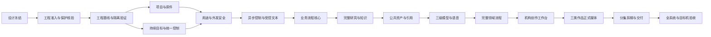

# 机构版主执行计划

D8-20261117-r1 设计冻结。来源为主合同12、次合同11、D0 R01–R38、O1–O7 和 Owner N08–N12 决策。本文件编排交付与依赖。当前进度与续跑位置见[执行状态](EXECUTION_STATUS.md)，业务退出条件见[阶段门](PHASE_GATES.md)。

## 设计顺序与交付归属

| 阶段 | 完整交付内容 | 回填权威与证据 | 需求 |
|---|---|---|---|
| D0 | 需求、决定、真实基线、文档治理、追踪 | 外部既有七文件；续接差异见状态/风险 | R01–R38 |
| D1 | 完整PRD、旅程、三类型差异、关键门、失败/恢复和验收 | PRODUCT、CREATION_FLOW；状态中审查结论 | R01–R38 |
| D2 | 领域模型/ER、所有新增及扩展表列/约束/索引/RLS/版本/删除语义 | DOMAIN_VOCABULARY、DATA_MODEL；对照实际ORM/Alembic，不执行迁移 | R01–R32、R35 |
| D3 | 两Runtime、Harness/LangGraph、MasterRun/BusinessFlow、控制/交接/恢复/并发 | CANONICAL_ARCHITECTURE、ARCHITECTURE、MODULE_BOUNDARIES、DIRECTOR_RUNTIME、PRODUCTION_RUNTIME、PRODUCTION_GRAPH、ARCHITECTURE_MAPPING | R19–R24、R28–R32 |
| D4 | 全格式解析、研究六类、引用、修正/恢复/差异、知识库、上下文 | PRODUCT、DATA_MODEL、API、DIRECTOR_RUNTIME | R02–R12、R24、R32 |
| D5 | 公共资产/项目变体/限制、媒体能力与Adapter、目的地/授权/撤销/安全 | MODEL_PROVIDER、DATA_MODEL、API、PRODUCTION_RUNTIME | R14–R18、R25–R32 |
| D6 | 信息架构、全部关键界面/状态、可操作高保真原型、浏览器检查 | FRONTEND_WORKBENCH、frontend/design既有规范；原型属设计产物非产品实现 | R01–R38的用户入口 |
| D7 | 精确API/Event/状态机、迁移与恢复、部署运维、测试矩阵、实施批次 | API、DATA_MODEL、Runtime两文档、DEPLOYMENT、DEVELOPMENT、此计划及门/证据 | 全部 |
| D8 | 全量一致性审计、修订、设计冻结、最终工程方案/依赖图/自动执行合同 | 各权威最终合同；此计划、门、决定、风险、状态汇总 | 全部 |

D6原型不得把mock成功当成真实功能。D8必须覆盖主合同十九项交付：PRD→PRODUCT；旅程→CREATION_FLOW；模型/ER/Schema→DATA_MODEL/词表；Director/Harness/LangGraph及目标/流程/生产合同→两Runtime/图；资料与文化研究→D4权威；资产→D5权威；模型/适配/安全→MODEL_PROVIDER；工作台及原型→FRONTEND_WORKBENCH；API/Event→API；状态机→各状态拥有域；迁移/兼容→DATA_MODEL；部署→DEPLOYMENT；测试→DEVELOPMENT及TEST_EVIDENCE中的矩阵；依赖与执行合同→本文件；一致性审计→EXECUTION_STATUS的D8报告。不能用仅有标题或链接视为完成。

## 工程分组与依赖

本表继承12初始编号，批次、精确文件、测试命令与退出条件已经D7/D8冻结。I号不等于旧P号，按O7依赖执行。

| 阶段 | 范围与最小交付 | 前置条件 |
|---|---|---|
| I0 | 权威一致、保留dirty、真实实例只读识别、隔离测试环境及基线 | D8通过；未知实例不迁移，不启动未知付费任务 |
| I1 | 项目/作品类型、私有原件/版本/提取基础和UI；仅合成资料验证 | I0 |
| I2a | MasterRun/Plan/控制回执、RuntimeControl统一接口，保留旧lease | I0；D2/D3冻结 |
| I3 | 项目外发策略、目的地和统一准入/撤销/拒绝路径 | I1项目身份、I2a控制 |
| I2b | 受控后台文本、epoch/锁/停止/恢复；排空及回归后另评估删旧lease | I3通过；无真实费用未经批准 |
| I6a | Harness/BusinessFlow核心、持久步骤/attempt/定义注册/恢复及已有受控工具接线 | I2b+I3；不以研究工具未接入的核心测试声称研究完成 |
| I4 | 全格式解析、研究修正来源、独立知识库和上下文，接入research_import_v1真实领域步骤 | I1+I2b+I3+I6a；真实资料接入前安全门通过 |
| I5 | 公共资产采纳/版本/引用/变体/限制及私有隔离 | I1+I3；来源链依赖I4 |
| I8a | 三级模型默认/单次选择、语音Binding与Edge退出、媒体安全合同、准备预览/逐命令授权；同步更新所有现有调用方 | I3+I5，涉及知识/公共引用的模型输入依I4/I5 |
| I6b | 完整领域Skills和各BusinessFlow接线、并行/部分失败/换计划验收；核心和领域均须通过 | I6a+I4+I5+I8a |
| I7 | 方向讨论、故事剧本、N08/N10三栏工作台、恢复与关键确认，收口模型配置交互 | I4+I5+I6b+I8a；I8a先同步受影响模型调用面，不保留旧DTO别名 |
| I8b | 三类作品完整业务编排和端到端生产；与I8a合计覆盖I8 | I7；固定媒体/本地验证先行，真实付费单独批准 |
| I9 | Review/Formal/Editing/FinalFilm/Export和分集交付 | I8b；保留既有FinalFilm未提交变更并验证整合 |
| I10 | 同候选集成、目标机安装/重启/备份恢复、三作品E2E、Full Gate/实际验收 | I1–I9退出，真实操作按审批执行 |

依赖主线：D0续接→D1→D2→D3→D4→D5→D6→D7→D8；依据主合同及N11进入工程准入后，
I0→I1/I2a→I3→I2b→I6a→I4→I5→I8a→I6b→I7→I8b→I9→I10。
斜线表示可分片但本任务默认串行；未授权委派，不自行创建子Agent。
旧P1→I2a；P2a→I2a；P3→I3；P2b→I2b；P2c→I2b最后评估；P4→I6；P5仅覆盖I7/I10部分执行体验，不能替代全机构验收。

图为主依赖，额外前置以表中合同为准；真实实例迁移还须先满足完整备份保护，不能仅按图序号执行。

## 执行合同

每阶段先核对HEAD/工作区/远端/迁移头/活动任务，再读当前权威与本阶段合同。按连贯切片实施，针对风险选unit/PG/API/UI/恢复，正式跨栈门按DEVELOPMENT。不修改测试预期迁就缺陷，不把代码存在或提交当完成。

每个可修复失败最多进行3次针对性修复尝试；每次先根因、原证据、修改、受影响验证。相同故障未经新证据不得重试；预算耗尽保留最小复现并升级，不降低门。可能计费/unknown_submission不属于重试预算，直接核对原操作。

默认不改动生产实例；N11已明确后续统一工程，D8通过后普通代码与隔离迁移测试按主合同推进，不提前绕过设计。
正式发布、破坏性迁移、真实资料扩大发送、真实费用执行还需主合同§8的具体批准。依赖未通过的分支不越过门，但可完成不依赖该分支的已授权设计工作。

D8已在ARCHITECTURE_MAPPING与TEST_EVIDENCE逐R条目记录精确文件、数据合同、API/Event、UI、自动化case及验收要求。下表是冻结实施任务书；验收证据须在实现后实际取得，不能将设计落点当测试通过。

## 实施批次合同（D8冻结，按依赖执行）

以下E=扩展/重构现有入口，N=拟新增同域模块；路径相对仓库。新增文件不得绕开MODULE_BOUNDARIES分类，
领域模型叶文件由已有同域models入口加载，不给shared/model_registry增加越界豁免。
每批按API/数据/权限/前端生成类型一起更新所有当前消费者；依赖未就绪时不开放入口，不保留过渡双写/旧DTO别名。
测试组T01–T16的精确文件在TEST_EVIDENCE，命令在DEVELOPMENT；完成含代码Review及受影响修复，不能只提交文件。

| 批次 | 实施范围与主要文件落点 | 前置/退出证据 |
|---|---|---|
| I0-01 | E docs/CURRENT.md及各权威、scripts/evidence_context.py既有身份机制；只读核对dev/HEAD/dirty/远端/实例Catalog/角色/活动操作 | D8通过及主合同/N11；保留原dirty与有用证据，不启动未知生产任务；C10真实事实齐全 |
| I0-02 | E docker-compose.quality.yml、backend/frontend Dockerfile.quality、scripts/run_quality_in_docker.ps1；按DEVELOPMENT增加隔离真实API/Workers/browser fixture | 构建固定image ID、合成配置、拒绝外网/真实Key；现有基线与首次Full如实记录，不因既有失败删除用例 |
| I1-01 | E app/access/models.py、projects.py、api/v1/projects.py与前端project API/CreateProjectForm；M01/M07基础项目列 | T01/API-P01，三类型/CAS/旧NULL与并发分集真实PG |
| I1-02 | E app/assets/models.py、project_files.py、source_parser.py、api/v1/project_files.py；N app/assets/source_models.py；N frontend/src/features/project-files/公开入口 | M04仅基础Extraction及纯本地提取，T02；此时只合成资料，不能启动尚未有安全基础的语义研究 |
| I2a-01 | N app/director/master_run_models.py、master_runs.py；E proposal_commands.py、turn_models.py、runtime/models.py同域注册 | M02，T06/DB07/12；Run来源/Plan/Receipt真实，普通对话无Run |
| I2a-02 | E app/director/runtime/control.py、executor.py、langgraph_adapter.py与原Agent控制调用方 | T08；统一接口/短事务/锁序，旧lease保留；未通过安全门不启用Worker真实文本 |
| I3-01 | N app/access/project_data_policy.py、egress_models.py；N app/providers/destinations.py；E api/v1/provider_connections.py；N api/v1/project_egress.py | M03，T09/API-S01–04；原current回归，目的地和来源用途无伪local |
| I3-02 | E providers/egress.py、reference_delivery.py、director/text_transport.py、Production发送入口；N app/assets/source_use.py、source_use_models.py | 各实际出口0拒绝/1未知，先后撤销屏障测试；SourceUse与策略/本次授权交集，不能只包一个check函数 |
| I2b-01 | E app/workers现有Director入口、director/agent_service.py、runtime执行/恢复、api/v1/director.py及消息调用方 | T08/API-D01/06；202受理/Outbox/断线/epoch/checkpoint真实；O6旧状态排空再评估删租约，不自动删除 |
| I6a-01 | N app/director/business_flow_models.py、business_flows.py；E runtime/inbox/wakeup/受控工具注册 | T07，实际持久Flow/Step/Attempt和已有领域工具链；不建立第三Runtime、不做无用空转 |
| I4-01 | E app/assets/source_parser.py分解到同域处理器、现有Worker与source_extract_v1；E backend/Dockerfile及quality/锁定依赖，固定OCR/ASR构建清单 | T02媒体真实七格式、本地零模型Flow/块回执、资源/定位/恢复；无组件不转云，不把整档超限伪成完整 |
| I4-02 | N app/assets/research_models.py、research.py、api/v1/research.py；E director上下文/固定research_import_v1定义与Worker装配 | T03/API-R全组；Analysis覆盖/零发现、当前修正与候选、恢复/并发/来源真实 |
| I4-03 | N app/assets/knowledge_models.py、knowledge.py、api/v1/knowledge.py；E events/models/service/outbox/sse；N frontend/src/features/research与knowledge公开API/页面 | T04/T13/API-K/E，独立知识非Asset镜像，同owner两Workspace及异owner拒绝；源私有字段不公开 |
| I5-01 | N app/assets/public_asset_models.py、public_assets.py、api/v1/public_assets.py；E version_service.py、from_artifact_service.py、models.py | M05，T05/API-A01–03；E05创建/采用回执、原子入库与metadata-only变体 |
| I5-02 | E references HTTP/解析、Production引用编译、provider reference_delivery/token、候选下载及前端资产API | T05/T09/API-A04；两窄权限路径、六列FK、撤销/来源闭包、无源私有SELECT放开 |
| I8a-01 | E providers/model_profiles/{orm,service,resolver,schemas}.py、model_resolution.py、selection.py及model_profiles HTTP；同步frontend模型组件/生成类型 | M06/T10/MC01–08，唯一项目默认/临时覆盖/旧配置显式核对；不留下可写旧媒体slot或隐藏Shot覆盖 |
| I8a-02 | E providers/voice_config.py、voice_runtime.py、production语音路径与FinalFilm prepare；N providers/speech_http.py；删除活动edge_tts.py/依赖/配置透传与相应旧默认 | T09/T10/API-F03，三个模型实际mock协议/字节解码，准备预览和逐命令授权先通过才启用语音；历史只读，无Edge/eSpeak兜底 |
| I8a-03 | E production/service.py、command_models.py、application/{commands,authorization,batch_production}.py、节点注册/事件及assets HTTP；N同Production内资产媒体计划构造模块 | T10/T15，asset Graph/grant同项目校验、无假Scene/Shot的图/视频/配音素材、候选不自动正式、语音分段与批次原回执；不新建Runtime |
| I6b-01 | E Director受控工具/Skills、固定业务定义、Plan Apply/完成predicate/事件监督；接真实研究/知识/公共资产/媒体端口 | T06–11，全部业务定义与部分失败/并行/重规划真实接线，I6a核心通过不能替代此批 |
| I7-01 | E frontend/src/components/workstation、routes、features/director/script/project/assets等公开入口；按N08/N10重做三栏，模型三级交互收口 | T14+T15；聊天/中央同ID、自然语言→结构要求、专业配置非必经步骤、正式门/权限/草稿恢复完整 |
| I7-02 | E Story/Script Proposal消费者与UI树、分集上下文、人物/场景正式设定绑定 | T11/T15；无孤儿部分Apply、版本过期、同名消歧、资料变化不自动覆写正式事实 |
| I8b-01 | E 三类型Project/Flow定义、ProductionGraph既有节点/能力编译与media测试；不新增作品专属Runtime | T10/T15的生产段到正式媒体，至少两集共享与连续性；完整剪辑交付段依I9，不能在I8b提前声称全交付通过；真实模型另需精确付费授权 |
| I9-01 | E app/editing/models.py、adapter.py、timeline_builder.py、api/v1/editing.py；前端editing/review | M07/T12/API-F01/02；分集与Clip.source schema2，已采用资产/公共素材直接复用不再生成；Save与Formal分离；保护原FinalFilm dirty成果 |
| I9-02 | E app/production/final_film.py、api/v1/final_film.py、delivery/models.py与既有导出服务 | T12/API-F04；固定版本/hash、原回执优先、MP4/SRT可解码与逐集交付，Export不隐藏新生成 |
| I10-01 | E scripts/p0_backup_restore.py与maintenance镜像/配置、app/config.py及API/Worker准入守卫/ready身份；锁定restic，target-config与恢复会话换钥 | T13/T16，完整多库/对象/密钥恢复与目标核验、原Create计数不增、旧会话无效；只隔离恢复，真实切换需批准 |
| I10-02 | E 原Full编排/目标机证据与三作品实际验收流程；更新权威和V1_STATUS的真实状态 | 同clean候选无过滤Full、Windows/WSL2/browser/重启/恢复、三作品真实质量证据、严重问题清零；无证据不关闭目标 |

上表backend路径中的app均位于backend/，front路径已完整标注；拟新增模块名称仅是合同落点，实施时若同域已有合适深模块，
先复用并同步本表，不能以计划名字为由并排造一套服务。恢复原操作的端口与新Create严格分开，所有付费动作仍须当前Owner授权。
数据库每批使用当时唯一head追加真实迁移，M编号不预留版本号；即使结构先建好也须前置验收通过才开放业务能力。
I0–I9的迁移与故障验证默认使用隔离合成库，不更新现有业务实例；若要迁移该实例，必须先完成I10-01中的
完整备份/隔离恢复工具和实际保护集验证，不因批次编号靠后而跳过前置保护。未具备维护准入模式的旧实例，
只能在明确批准窗口停止其入口/写者并核对未决任务后取一致备份，不能设置不存在的开关冒充已隔离。

## 门分级与提交节奏

阶段内按相关 T 组、实际调用方与受影响回归集中验证。连贯批次的提交点、交付候选检查与 Full 触发规则统一遵循[开发验证规则](../DEVELOPMENT.md)。业务退出按[阶段门](PHASE_GATES.md)逐项核对。

| 阶段 | 集中验证范围 |
|---|---|
| I8a | T10/T09、受影响 PG、生成类型和媒体生产调用方 |
| I6b | T06–T11 业务定义、部分失败、并行、重规划及实际端口 |
| I7 | 前端 Vitest、受影响 E2E 和 T14/T15 工作台旅程 |
| I8b | 生产图、媒体编译、计数 Mock 旅程 |
| I9 | T12、Clip schema2、Save/Formal 分离、FFmpeg 交付 |
| I10 | T16、同一干净候选的无过滤 Full、目标机和三类作品真实验收。真实操作按 Owner 授权窗口执行 |

历史证据见[测试记录](TEST_EVIDENCE.md)。I4-03 的四个切片各有通过的 Full（EV81–EV84）。I5 在公共引用尚未接入 Production 编译时已有一次 Full 通过（EV92），补齐该消费者后对新候选再次通过（EV93）。

### 每批统一入口、Review与退出

读实际文件及当前dirty → 核对本批需求/authority/API/schema → 实施完整竖向切片 → 相应T组 →
按业务门/并发/权限/副作用/恢复Review → 修正与受影响回归 → 更新唯一状态。就绪的用户流程按开发规范交付试用，后续任务按依赖继续。
每条失败保留原证据，最多3次有根据修复后仍失败才升级；未知提交不属于可重发预算。
新表/新API/新UI孤立存在不是完成，必须证明实际调用链与对应负向拒绝。
最终正式验收需要干净候选；未提交成果与原dirty必须合法整合，不以reset/清空工作区制造clean。
N11已明确全部后续统一执行；D8完成后按主合同进入I0，不再重复请求普通阶段许可。

